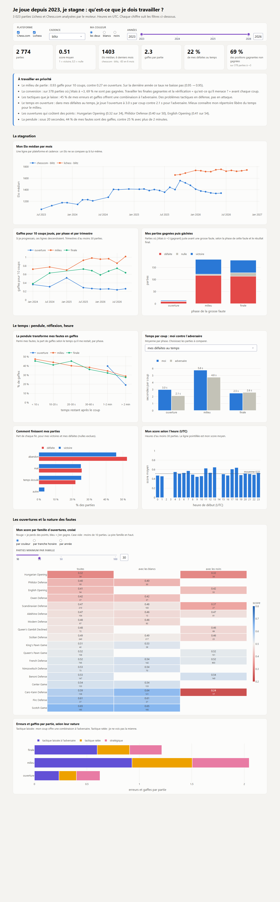

# Analyse de performance aux échecs : pourquoi je stagne ?

> « Je joue depuis 2023, je stagne : qu'est-ce que je devrais travailler ? »

Un dashboard qui répond à cette question à partir de 3 023 parties Lichess et Chess.com
(juillet 2023 à novembre 2026), analysées coup par coup par un moteur d'échecs.
Le même dashboard existe en deux versions : **Dash** et **Streamlit**, qui partagent les mêmes
calculs et les mêmes figures.

Projet réalisé pendant le cours *Applications web de données avec Python* (CODA Orléans, M2-D),
à partir du gabarit [jlkhermes38/awp-gabarit](https://github.com/jlkhermes38/awp-gabarit).
L'énoncé d'origine est conservé dans [`docs/ENONCE.md`](docs/ENONCE.md).



## Lancer

Prérequis : Python 3.12 et [uv](https://docs.astral.sh/uv/).

```bash
uv sync
```

| Appli | Commande | Adresse |
|---|---|---|
| Dashboard Dash | `uv run python fil_rouge/dashboard.py` | http://127.0.0.1:8051 |
| Appli Streamlit | `uv run streamlit run fil_rouge/app_streamlit.py --server.address 127.0.0.1` | http://127.0.0.1:8501 |
| Les 3 figures de l'exo 1 | `uv run python fil_rouge/01_figures.py` | ouvre le navigateur |
| Vérifier le chargement des données | `uv run python fil_rouge/data.py` | terminal |
| Imprimer tous les agrégats | `uv run python fil_rouge/analyses.py` | terminal |

Au premier lancement, Streamlit demande un e-mail : Entrée pour passer.

## Ce que montre le dashboard

Tout suit les filtres : plateforme, cadence, couleur jouée, période.

- **Indicateurs** : parties, score moyen, Elo médian des 6 derniers mois et sa variation,
  gaffes par partie, part des défaites au temps, part des positions gagnantes non gagnées.
- **À travailler en priorité** : des conclusions écrites, recalculées pour les filtres choisis.
- **La stagnation** : l'Elo médian par mois (une courbe par plateforme et cadence), les gaffes
  pour 10 coups par phase et par trimestre, les parties gagnantes puis gâchées.
- **Le temps** : la part de gaffes selon le temps restant à la pendule, par phase ; le temps par
  coup contre celui de l'adversaire ; comment finissent les parties ; le score selon l'heure.
- **Les ouvertures** : une carte de chaleur famille d'ouvertures × couleur, tranche horaire ou
  année, et la nature des fautes (tactique laissée, tactique ratée, stratégique) par phase.

L'appli Streamlit reprend en plus l'exo 2 du cours : barre latérale, trois indicateurs, les deux
figures de l'exo 1, et un clic sur une famille d'ouvertures qui liste ses parties.

## Ce que disent les données (blitz, toutes plateformes)

1. **L'Elo est plat** : environ 1 400 sur Chess.com depuis fin 2024, environ 1 730 sur Lichess
   depuis début 2026.
2. **Le milieu de partie** concentre les gaffes : 0,93 pour 10 coups, contre 0,27 en ouverture,
   et ce taux ne baisse pas d'une année sur l'autre.
3. **La conversion** : sur 378 parties où j'étais à +3 avant une grosse faute, 69 % ne sont pas
   gagnées.
4. **Les tactiques laissées à l'adversaire** représentent 45 % de mes erreurs et gaffes.
5. **Le temps** : dans mes défaites au temps, je joue l'ouverture à 3,0 s par coup contre 2,1 s
   pour l'adversaire ; sous 20 s à la pendule, 44 % de mes fautes sont des gaffes, contre 25 %
   avec plus de 2 minutes.
6. **Les ouvertures qui coûtent des points** : Hungarian Opening (0,32), Philidor Defense (0,40),
   English Opening (0,41).

Ce sont des corrélations, pas des causes : le lien pendule-gaffes, par exemple, mêle la pression
du temps et la difficulté des positions où l'on réfléchit longtemps.

## Organisation du code

```
fil_rouge/
├── data.py           # chargement et validation de parties.csv et coups_juges.csv
├── analyses.py       # filtres et agrégats (Elo, phases, pendule, ouvertures, conversion…)
├── graphiques.py     # une fonction par figure, commune à Dash et Streamlit
├── theme.py          # couleurs et gabarit Plotly
├── dashboard.py      # le dashboard Dash (callbacks d'une ligne vers graphiques.py)
├── app_streamlit.py  # l'appli Streamlit (exo 2 en haut, dashboard en onglets)
├── assets/
│   └── dashboard.css # mise en page du dashboard Dash
└── 01_figures.py     # les trois figures de l'exo 1
data/echecs/          # les données (voir data/echecs/LISEZMOI.md)
```

Les calculs se font côté serveur, en pandas, et seules les données agrégées partent vers le
navigateur. Les fichiers CSV sont lus une seule fois par processus.

## Données

Les parties d'un joueur, exportées de ChessXP et anonymisées (adversaires remplacés par un hash),
fournies avec le gabarit du cours. Les colonnes et leurs pièges sont décrits dans
[`data/echecs/LISEZMOI.md`](data/echecs/LISEZMOI.md), et la façon dont le moteur juge un coup
dans [`data/echecs/conseils.md`](data/echecs/conseils.md).
